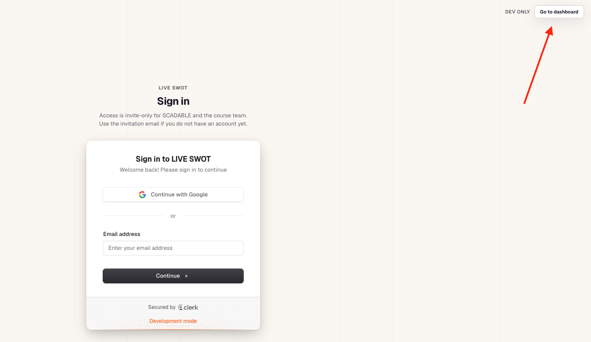
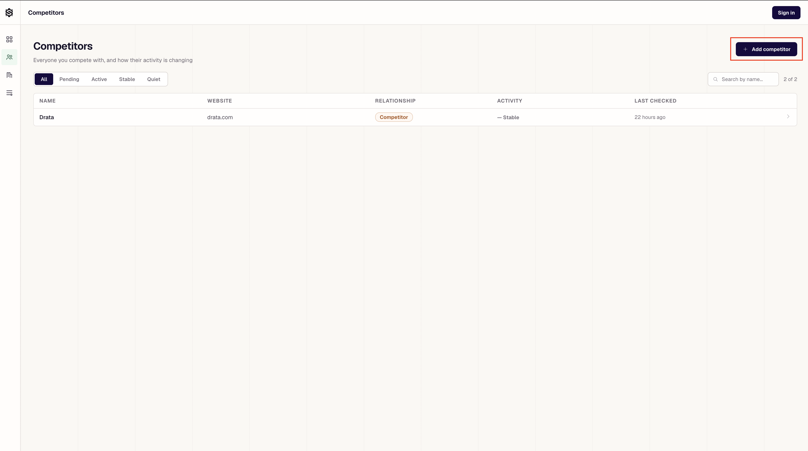
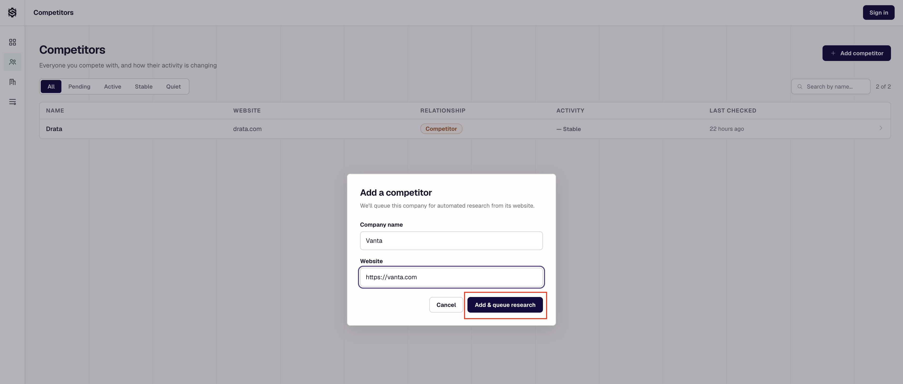
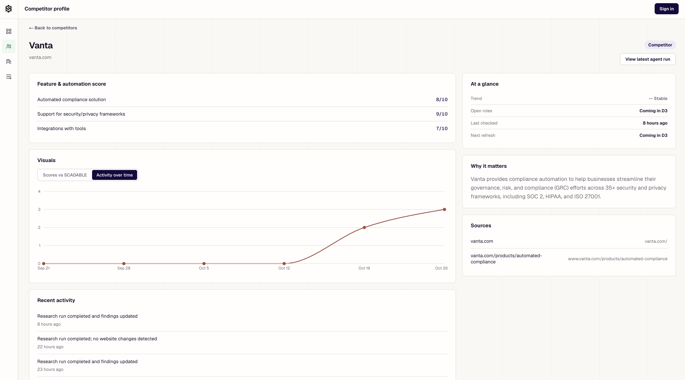
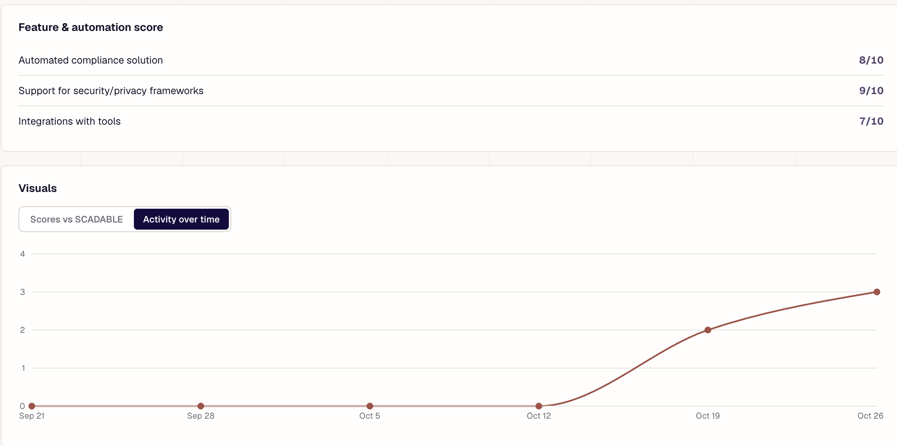
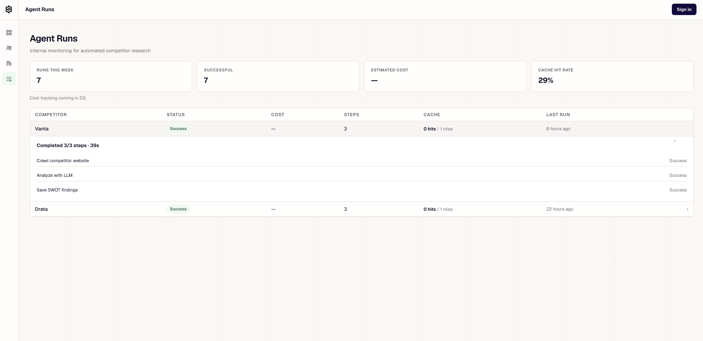
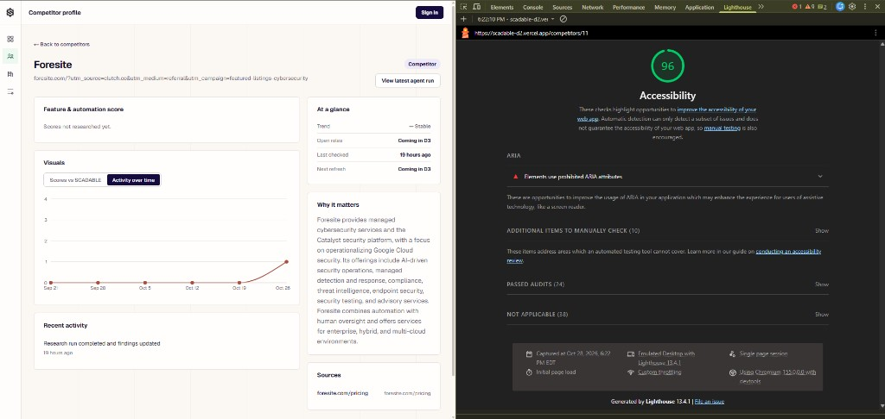
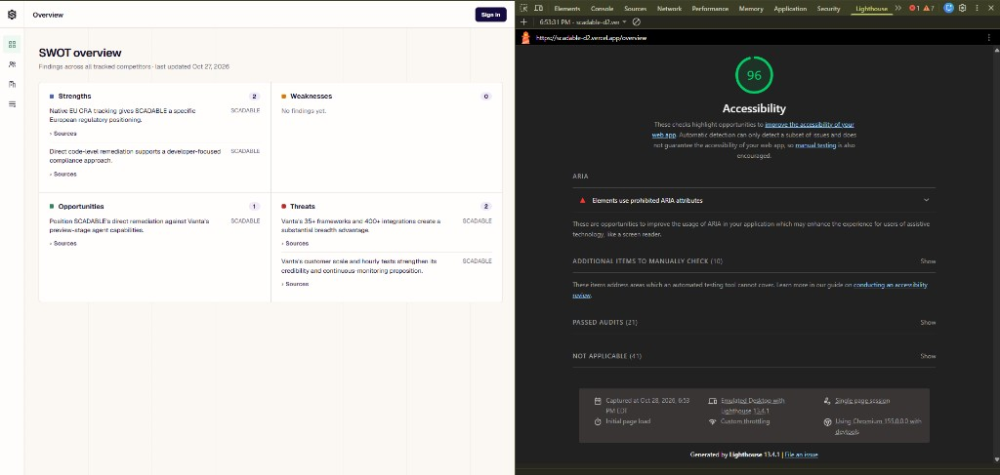

# Live SWOT

**Team 10 – Niche | CSC301 | Deliverable 2**

Live SWOT is a competitor-intelligence application developed for SCADABLE. It automatically researches competing companies and organizes findings into a SWOT analysis, helping SCADABLE understand its competitive position without manually researching every competitor.

## Partner Introduction

Our project partner is **SCADABLE**, an AI-powered compliance company that helps startups and small and medium-sized businesses automate security compliance processes, including SOC 2 and HIPAA preparation.

Our primary contact is **Ali Rahbar**, co-founder of SCADABLE (a.rahbar@scadable.com). **Hossein Molavi**, also a co-founder (h.molavi@scadable.com), has been involved in project communications.

## Project Description

### The Problem

SCADABLE operates in a competitive market where companies regularly introduce new products, features, integrations, and compliance capabilities.

Tracking this information manually is time-consuming. It is difficult for SCADABLE's founders and sales team to keep up with competing offerings and understand how their own product compares.

### Our Solution

**Live SWOT** centralizes competitor research in one application.

Users can add companies to track, initiate automated website research, view individual competitor profiles, and examine an overall SWOT analysis from SCADABLE's perspective.

The application helps users identify SCADABLE's strengths, weaknesses, market opportunities, and competitive threats using information collected from competitor websites.

## Key Features and Use Cases

### 1. Authentication and Dashboard Access

Live SWOT includes a sign-in page implemented using **Clerk**. Account registration is currently invitation-only for SCADABLE and the course team.

For D2 evaluation, the deployed application also provides a **Dev only → Go to dashboard** option, allowing evaluators to access the dashboard without an account.

**Example use case:** A course evaluator visits the application and selects **Go to dashboard** to explore its features without needing login credentials.



### 2. Competitor Management

Users can view tracked competitors, search and filter the list, and add new companies by entering their names and website URLs.

**Example use case:** A SCADABLE team member wants to expand their competitive research by tracking Vanta alongside Drata. They use the **Add Competitor** form to enter Vanta's name and website URL, allowing Live SWOT to automatically research the company and generate competitive insights.





### 3. Automated Competitor Research

Live SWOT uses a research pipeline to collect information from competitor websites and analyze it with an AI language model.

The pipeline extracts relevant company information, identifies competitive strengths and weaknesses, and generates structured findings supported by source URLs when available.

Research results are stored in a PostgreSQL database, allowing users to revisit findings and compare companies without repeating the entire research process manually.

**Example use case:** After adding Vanta as a competitor, a SCADABLE team member monitors its automated research run and reviews the AI-generated findings to better understand Vanta's products, capabilities, and competitive strengths and weaknesses.



### 4. Competitor Profiles

Each tracked company has a profile displaying available information such as its website, summary, research status, recent activity, and research sources.

Competitor profiles include a **Feature & Automation Score** section intended to show how competitor capabilities compare with SCADABLE's offerings on a 0–10 scale. This functionality is implemented in the research pipeline, but scores are not consistently generated in the current D2 deployment. When scores are unavailable, the interface displays "Scores not researched yet."

An **Activity over time** chart displays historical research activity for the competitor.

**Example use case:** A sales team member opens Vanta's profile to review its product positioning, research findings, recent activity, and supporting sources. Feature scores can also be reviewed when available.



### 5. Overall SWOT Analysis

The SWOT Overview organizes SCADABLE's competitive position into four categories:

- **Strengths:** SCADABLE's competitive advantages and capabilities.
- **Weaknesses:** Supported limitations or disadvantages.
- **Opportunities:** Areas for growth or improved competitive positioning.
- **Threats:** Market and competitor-related challenges.

The analysis uses SCADABLE's current product baseline and research from tracked competitors.

For D2, SCADABLE's product information is maintained as a static baseline. Automatic synchronization from GitHub is planned for D3.

**Example use case:** A SCADABLE founder opens the SWOT Overview to examine the available competitive findings across tracked companies such as Vanta and Drata, helping identify potential strengths, weaknesses, opportunities, and threats.

**D2 limitation:** The SWOT Overview is implemented and displays saved findings, but the overall comparison does not consistently populate all four categories. Individual competitor research can still generate findings with supporting source URLs. Improving the completeness and reliability of the overall SWOT analysis remains a priority for D3.

### 6. Agent Runs and Research History

The Agent Runs page allows users to monitor automated research tasks.

Users can inspect run status, the competitor being researched, workflow steps, and available caching information.

Each research run displays its main stages:

- Crawling the competitor website
- Analyzing the collected information with an LLM
- Saving the resulting SWOT findings

**Example use case:** A user opens Agent Runs to check whether website crawling, LLM analysis, and saving research findings have completed successfully.



## How to Use Live SWOT

### Deployed Application

**Application URL:** https://scadable-d2.vercel.app/

The D2 application is accessible through a web browser. No installation or technical knowledge is required.

Visitors are presented with a Clerk sign-in page. Invited users can sign in with their accounts.

**For D2 evaluation, no account or password is required.** Evaluators can select **Dev only → Go to dashboard** on the sign-in page to access the application.

The development dashboard shortcut is also available at:

https://scadable-d2.vercel.app/api/dev/dashboard-bypass

This access method is intended for development and course evaluation rather than production authentication.

### Getting Started

1. Open https://scadable-d2.vercel.app/ in your browser.
2. On the sign-in page, select **Go to dashboard** to access the D2 application without an account.
3. Visit **SWOT Overview** to examine SCADABLE's current competitive analysis.
4. Open **Competitors** to browse existing tracked companies.
5. Click **Add Competitor** and enter a new company name and website URL. Use a company that is not already being tracked.
6. Submit the form to add the competitor and initiate research.
7. Open **Agent Runs** to monitor research progress. Research may take some time to finish.
8. Return to **Competitors** and open the company's profile to review its research summary, recent activity, available sources, and feature scores when generated.
9. Visit **SWOT Overview** to examine the currently available competitive findings. Some SWOT categories may remain empty in the D2 deployment.

### D2 Scope and Limitations

This release focuses on competitor management, automated research, research-run monitoring, competitor profiles, and the overall SWOT analysis.

Some additional features are planned for D3:

- **GitHub product integration:** Automatic synchronization of SCADABLE's product features from GitHub. D2 uses a static baseline.
- **Scheduled research:** Recurring automatic research without manual initiation.
- **Scores vs SCADABLE:** Direct comparisons between competitor scores and SCADABLE's own scores. D2 includes the competitor scoring interface, but generated scores are not consistently available.
- **Open-role monitoring:** Tracking hiring activity from competitor job listings.
- **Detailed research cost analytics:** Expanded AI research cost monitoring.

Some websites restrict automated crawling. When live crawling or analysis is unavailable, the system may use fallback data, so a completed research run does not necessarily indicate that all information was collected live.

The main competitor research and SWOT workflow is available for testing in D2.

**Known D2 limitations:** Although feature scoring and the overall SWOT comparison are integrated into the application, the deployed system does not consistently produce feature scores or a complete four-category SWOT analysis. Automated competitor research, competitor profiles, source links, persistent storage, and research-run monitoring remain available. These limitations will be addressed through further integration and testing in D3.

## Technical Overview

Live SWOT uses the following technologies:

| Component | Technology | Purpose |
|---|---|---|
| Frontend | Next.js, React, TypeScript | Web interface |
| Authentication | Clerk | Sign-in and account management |
| Backend | Python, FastAPI | API and research orchestration |
| Database | PostgreSQL | Persistent application data |
| Web research | Crawl4AI | Competitor website crawling |
| AI analysis | OpenAI | Structured competitive analysis |
| Frontend deployment | Vercel | Hosted web application |
| Backend and database deployment | Railway | Hosted API and PostgreSQL |

The research workflow follows these main steps:

```
Add competitor
      ↓
Queue research run
      ↓
Collect website content with Crawl4AI
      ↓
Analyze competitor information with OpenAI
      ↓
Save findings in PostgreSQL
      ↓
Display competitor profiles, agent runs,
and SWOT analysis
```

## Development Requirements

Non-technical users should access the deployed application. Local setup is intended for developers.

### Requirements

- Python 3.12
- Node.js and npm
- PostgreSQL
- Git

### Frontend

From the repository root:

```bash
cd frontend
npm install
npm run dev
```

Open http://localhost:3000.

Configure the API connection in the frontend environment:

```text
NEXT_PUBLIC_API_URL=http://localhost:8000
NEXT_PUBLIC_USE_MOCKS=false
```

Clerk authentication requires the appropriate environment variables:

```text
NEXT_PUBLIC_CLERK_PUBLISHABLE_KEY
CLERK_SECRET_KEY
```

Developers should obtain the required credentials from the team and configure them locally. Secrets and environment files should not be committed to GitHub.

### Backend

From the repository root:

```bash
cd backend
python3.12 -m venv .venv
source .venv/bin/activate
pip install -r requirements.txt
uvicorn app.main:app --reload
```

The backend runs at http://localhost:8000, with API documentation available at http://localhost:8000/docs.

Local backend use requires the appropriate environment configuration, including a PostgreSQL connection and credentials for live AI research.

### Standalone Research Pipeline

The repository also contains a standalone Python research pipeline.

- `scraper/` handles website content collection.
- `llm/` handles AI analysis, prompts, and structured outputs.

Additional documentation:

- [Research Pipeline Guide](docs/research-pipeline.md)
- [Scraper Documentation](scraper/README.md)

## Git and GitHub Workflow

Our team uses GitHub for version control and Discord for development coordination.

We follow a feature-branch and pull-request workflow:

1. Team members discuss and divide tasks before beginning development.
2. Each developer creates a separate branch instead of committing directly to `main`.
3. Work is committed and pushed to the developer's branch.
4. The developer opens a pull request targeting `main`.
5. Another team member reviews the changes before merging.
6. Integrated changes are tested before deployment.

We divide responsibilities across frontend development, backend research, LLM analysis, database integration, deployment, and documentation.

This workflow helps our seven-member team avoid conflicting changes, review code quality, and maintain a stable shared branch.

### Deployment Workflow

The D2 frontend is deployed on **Vercel**, while the backend API and PostgreSQL database are hosted on **Railway**.

**Frontend:** https://scadable-d2.vercel.app/

**Backend API:** https://backend-production-31e1b.up.railway.app/

Backend deployments use the Railway CLI. Frontend deployments are managed separately through Vercel.

The team coordinates deployments to maintain compatibility between frontend and backend changes.

## Coding Standards and Guidelines

We follow the existing naming conventions and directory structure of each component.

Pull requests should contain related changes, avoid unnecessary modifications, and be reviewed before merging. We also avoid committing credentials or API keys to the repository.

Tests are updated when relevant functionality changes.

## Non-functional requirements (accessibility & security)

D3 non-functional goals: Lighthouse accessibility **> 80**, keyboard-usable core workflows, labeled forms with accessible errors, validated user input, and no secrets or sensitive stack traces exposed to clients.

### Accessibility

| Requirement | Status / evidence |
| --- | --- |
| Lighthouse accessibility **> 80** | Verified on core Live SWOT screens (Chrome DevTools → Lighthouse → Accessibility): **98** and **96**. Re-check with `npx lighthouse <url> --only-categories=accessibility --view`. |
| Keyboard navigation | Competitor and agent-run lists support Enter/Space; dialogs use Escape and a **focus trap**; profile chart tabs support arrow keys. |
| Form labels and accessible errors | Add Competitor uses visible labels, `aria-invalid` / `aria-describedby`, and `role="alert"` for field and submit errors. |
| Contrast and semantic HTML | App shell uses landmarks (`main`, `nav`), headings, and tables; focus styles via `:focus-visible`. |





### Security

| Requirement | Status / evidence |
| --- | --- |
| Frontend input validation | Add Competitor validates required name/website, length limits, and http(s) URLs before calling the API (`frontend/lib/validation/competitor.ts`). |
| Backend input validation | FastAPI/Pydantic validates create-competitor bodies (name length, sources, `clean_url`). Covered by `backend/tests/test_api.py` (`test_create_competitor_validation`). |
| Secrets not in client or API responses | Browser only receives `NEXT_PUBLIC_*` values and the Clerk publishable key. `CLERK_SECRET_KEY`, database URLs, and OpenAI keys stay in server env. Response schemas do not return credentials. |
| Backend errors without stack traces | Unexpected exceptions return `{"detail": "Internal server error."}` (`backend/app/api/errors.py`). Evidence: `test_unexpected_error_returns_clean_500` in `backend/tests/test_api.py`. |
| Frontend does not show raw server internals | API 5xx bodies are not passed into UI copy; list/profile/runs errors use safe user-facing messages (`frontend/lib/errors.ts`, `frontend/lib/api/client.ts`). |
| Research-run error sanitization | Unexpected research failures are logged server-side, while only generic errors are persisted. API serializers also sanitize previously stored errors in `/runs` and competitor activity. Covered by `test_failed_run_does_not_expose_sensitive_errors` and the orchestrator failure tests. |

## License

Live SWOT was developed as part of CSC301 in collaboration with SCADABLE.

SCADABLE has expressed that our team is free to use and share the work developed for this project and has not requested additional confidentiality restrictions.

SCADABLE follows a mixed licensing approach, maintaining proprietary repositories while selectively releasing projects as open source. Our team intends to keep Live SWOT available for academic collaboration and future development, with any formal open-source licensing decisions made in coordination with the project partner.

## Deliverable History

- **D1:** Interactive frontend prototype and initial project design.
- **D2:** Deployed full-stack application with competitor research, persistent data, research-run monitoring, authentication UI, and SWOT analysis.
- **D3 (planned):** Additional automation, integrations, and product improvements.

The original D1 prototype remains available [here](https://csc301-2026-f.github.io/10-SCADABLE/deliverables/D1/mockups/final-prototype.html).