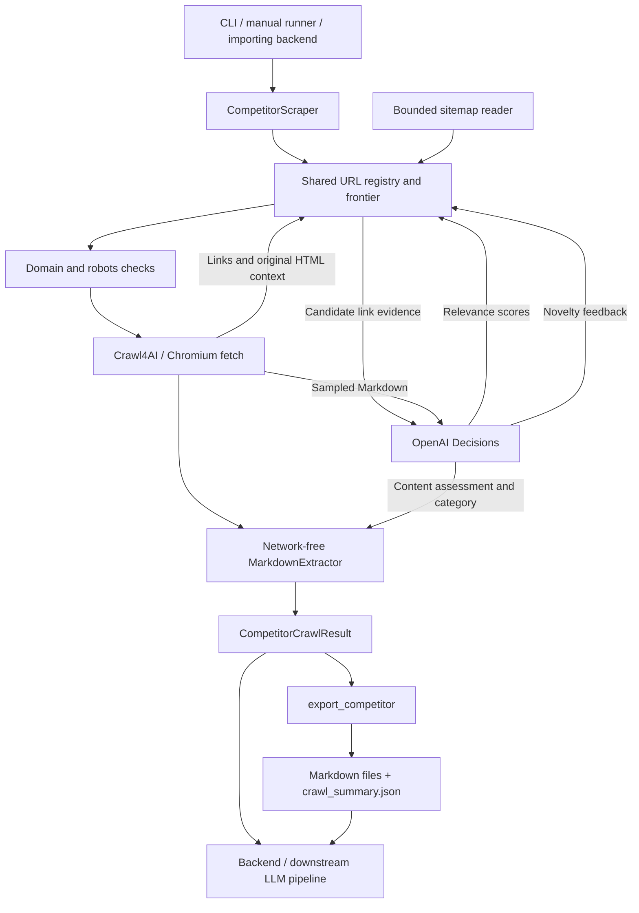

# Scraper architecture and integration guide

The scraper accepts competitor homepage URLs, discovers and prioritizes subpages, and
returns source-linked content for another application to analyze. It runs independently.
**Existing interfaces are Python and CLI; there are no HTTP/FastAPI endpoints.** Backend
jobs, database persistence, downstream LLM analysis, and scheduling are not implemented.

## 1. Architecture and workflow



| Component | Actual entry point / module | Responsibility |
| --- | --- | --- |
| Public orchestration | [`CompetitorScraper`](../src/service.py) | Compose resources, enforce shared capacity, retry fetches, isolate failures |
| Discovery loop | [`DiscoveryCrawler.run()`](../src/discovery/engine.py) | Merge discoveries, fetch batches, and collect decision feedback |
| URL registry and order | [`UrlFrontier`](../src/discovery/traversal.py) | Deduplication, page/depth accounting, ranked selection, exploration, BFS |
| Sitemap and policy | [`BoundedSitemapDiscoverer`](../src/discovery/sitemaps.py), [`GuardedHttpClient`](../src/discovery/http.py) | Bounded XML/HTTP discovery, robots and redirect checks |
| Browser fetch | [`Crawl4AIFetcher`](../src/browser.py), [`crawl4ai_adapter.py`](../src/crawl4ai_adapter.py) | Headless JavaScript rendering, configured interactions, SDK result mapping |
| Decisions | [`AdaptiveSelection`](../src/discovery/selection.py), [`OpenAIDecisionProvider`](../src/decisions.py) | Evaluation cycles, API lifecycle, budget and feedback |
| Extraction | [`MarkdownExtractor.extract()`](../src/extraction.py) | Normalize generated Markdown; consume the existing category assessment |
| Contracts and export | [`models.py`](../src/models.py), [`export_competitor()`](../src/output.py) | Pydantic results and local bundle publication |

For each competitor:

1. Resolve settings and validate LLM credentials before browser/network activity.
2. Force the homepage first. Discover its SDK-extracted links and context from original
   rendered HTML. Read robots-declared and common sitemap locations within configured bounds.
3. Normalize URLs, remove fragments/tracking parameters, deduplicate, and apply exact-host,
   URL-pattern, file-type and depth restrictions. Sitemap entries start at logical depth 1;
   that is not a measured distance through links.
4. Evaluate eligible candidates and select pages from one shared frontier per competitor.
   Successful fetches can contribute more links. Robots preflight refusals release their reservation.
5. Assess successful fetched content with Decisions. API waits do not hold browser slots.
6. After discovery finishes, extract each page into `ScrapedPage`; return a complete
   `CompetitorCrawlResult`. Results are not streamed page by page.
7. Optionally export the result. Calling the Python service alone does not write files.

Markdown generation omits images and, by default, semantic navigation and site footers.
Cleanup runs on an HTML copy, preserving original discovery links. The extractor makes
only conservative line-ending/control-character changes. `raw_markdown` therefore means
the full generated Markdown **after these generation settings**, not an untouched HTML archive.

## 2. Decisions API: scoring, not a separate crawler

The provider calls `AsyncOpenAI.decisions.create()` with `gpt-6-luna`. Prompts and rubrics
are in [`decision_prompts.py`](../src/decision_prompts.py); evidence contracts are in
[`decision_models.py`](../src/decision_models.py).

| Operation | Evidence supplied | Questions / result |
| --- | --- | --- |
| Before fetching candidates | Research objective, candidate IDs/URLs, discovery source, and up to two link observations | Named `candidate_0`, etc.; expected usefulness scored against four ordered levels |
| After a successful fetch | URL/title, up to 6,000 Markdown characters sampled across the page, and up to eight prior source-linked excerpts of 500 characters | Named `usefulness`, `novelty`, and `category` |

Each link observation includes parent URL, anchor text (160 characters), heading (160),
surrounding text (400), and location: navigation/main content/footer/unknown. Sitemap-only
entries may lack text context. Candidates are not fetched just to investigate them.

The configurable objective researches offerings, customers, differentiation, commercial
activity and observable expansion/contraction. Policy instructions favor company-specific
evidence, treat website text as untrusted evidence, regard missing context as uncertainty,
and forbid inferring actual growth from marketing claims. Candidate instructions append
`Rate the expected usefulness of candidate {candidate_id}.`

Usefulness levels are **No apparent value / Uncertain value / Useful information /
Substantial information**. Returned 0–3 scores are normalized to 0–1. Novelty levels range
from repetition to substantial addition. Category is a fixed choice from `PageCategory`,
including `other`. See the [official Decisions guide](https://developers.openai.com/api/docs/guides/decisions)
for scored-question semantics.

The application controls traversal:

- Evaluate at most 50 candidates per cycle, fairly across URL sections. Requests split
  further at 48 KiB. Evaluate after homepage/sitemap discovery, every five distinct page
  attempts since evaluation, or earlier when no scored eligible candidate remains.
- Cache scores; permit one refresh for changed anchor/surrounding-text evidence.
- Force the homepage. With default 20% exploration, every fifth non-homepage attempt explores.
  Other turns prefer scored candidates using
  `0.70 * relevance + 0.20 / (1 + section_attempts) + 0.10 * section_novelty`.
- A section is hostname plus first path segment. Novelty is its mean assessed novelty,
  defaulting to 0.5. Exploration favors least-attempted sections, fewer evaluations,
  shallower depth, then discovery order.
- Low scores do not permanently exclude pages. Individual invalid/refused answers remain
  unscored. Confidence is not a ranking weight; written rationales are not requested.

**Current limits:** candidate scoring receives no separate company profile or list of
missing research topics. The evidence ledger is used for fetched-content assessment,
not candidate scoring. Not every discovered URL is evaluated before the crawl limit.
BFS skips candidate scoring but still assesses fetched content in LLM mode. Structural
mode makes no OpenAI calls; unassessed categories use `other`.

## 3. Setup and invocation

Use Python **3.12**. From `scraper/`:

```powershell
uv sync --locked
uv run --locked python -m playwright install chromium
uv run --locked scraper --help
```

For LLM mode, create `.env` from `.env.example` if absent and set `OPENAI_API_KEY` there.
Do not put credentials in Python/TOML settings. Chromium must be installed in the runtime
environment; deployment-specific system libraries may also be required.

```powershell
uv run --locked scraper https://competitor.example/ --max-pages 10 --output output/run-001
uv run --locked scraper --config config.example.toml --output output/run-002
uv run --locked python manual_test.py
```

Replace example URLs before running. Multiple positional homepages are supported. The
manual runner exposes `WEBSITES`, `SETTINGS`, and `OUTPUT_DIRECTORY`; its explicit settings
override package defaults. It currently uses 10 pages versus the package default of 50.
Add `--selection-mode structural` for API-free CLI crawling.

Required input is an HTTP(S) homepage with no subpage, query, fragment or URL credentials.
`CompetitorInput` also accepts optional `name` and per-competitor `overrides`.

## 4. Python and FastAPI integration

Install this package in the backend's environment (for a local checkout, install the
`scraper/` directory). Its flat `src/` files are packaged as the import namespace `scraper`.
Importing models or constructing the service does not start a browser or load `.env`.

| Existing callable | Result / use |
| --- | --- |
| `load_environment(path=None, required=False)` | Explicitly load one `.env`; existing process values win |
| `load_config(path)` | Load TOML into `ProjectConfig` |
| `resolve_config(global_settings, competitor_overrides, cli_overrides)` | Merge and validate settings |
| `await CompetitorScraper().crawl(competitor, settings, *, cli_overrides=None)` | One complete `CompetitorCrawlResult` |
| `CompetitorScraper().crawl_many(competitors, global_settings, *, cli_overrides=None)` | Async iterator of completed competitors, in completion order |
| `export_competitor(result, output_directory)` | Synchronously write one bundle; return `CrawlExportSummary` |
| `competitor_directory(homepage)` | Derive the website's export directory name |

Example adapter for a backend-owned async handler/job; this defines no HTTP endpoint:

```python
import asyncio
from pathlib import Path

from scraper import CompetitorInput, ScraperConfig, SelectionConfig
from scraper.environment import load_environment
from scraper.output import export_competitor
from scraper.service import CompetitorScraper

# At application startup: use the application's chosen path, or host-provided env vars.
load_environment(Path("scraper/.env"))

async def collect_company(homepage: str, run_root: Path):
    settings = ScraperConfig(
        max_pages=10,
        selection=SelectionConfig(mode="llm", budget_usd=0.03),
    )
    result = await CompetitorScraper().crawl(
        CompetitorInput(homepage_url=homepage), settings
    )
    summary = await asyncio.to_thread(export_competitor, result, run_root)
    return result, summary
```

The backend awaits `collect_company()`, checks `result.run_status`, and can serialize
`summary.model_dump(mode="json", exclude_none=True)` for an HTTP response. Derive the
index path as `run_root / competitor_directory(homepage) / "crawl_summary.json"`.
Allocate a unique run root per invocation. For concurrent competitors, use `crawl_many()`
so they share capacity ceilings; separate `crawl()` calls have independent limits.

Close a multi-company iterator if consumption stops early:

```python
from contextlib import aclosing

async def collect_many(competitors, settings):
    async with aclosing(CompetitorScraper().crawl_many(competitors, settings)) as results:
        async for result in results:
            yield result
```

Consume this wrapper fully or close it too. In FastAPI, use the existing event loop;
do not call `asyncio.run()` inside an async handler. Exporting is synchronous disk work,
so the example moves it to a thread. The backend owns request timeouts, admission control,
job IDs/status routes, output storage and access. A durable background-job workflow is
a backend integration choice, not an existing scraper feature. Cancellation closes owned
resources and does not return a fabricated complete result for the interrupted competitor.

## 5. Outputs and the LLM pipeline

```text
output/run-001/
  competitor.example/
    crawl_summary.json       # Compact index; schema 2.1
    decisions.jsonl          # Optional diagnostic trace
    pages/
      index.md
      pricing.md
      products/analytics.md
```

Paths illustrate a normal HTTPS hostname; query variants, collisions, long paths and
other origins receive safe suffixes/directories. **Follow `markdown_file`; do not guess paths.**

| Contract | Content available |
| --- | --- |
| `CompetitorCrawlResult` (schema `1.1`) | `pages`, full `discovered_urls`, `summary` counts, effective config, warnings, decision usage/trace, `run_status`, `completion_reason` |
| `ScrapedPage` | Source/final URLs, title/category, UTC timestamp, status/error, attempts, raw/cleaned/optional filtered Markdown, metadata, typed assessment and selection diagnostics |
| `CrawlExportSummary` (schema `2.1`) | `pages` with relative file references and essential metadata; `uncrawled_urls` with reasons/provenance; counts, `status`, completion reason, decision usage |

Each successful page writes its **cleaned Markdown only**, without metadata front matter.
Failed pages remain in the index with an error and no Markdown file. The index omits page
bodies, full metadata/config and typed content assessments. `raw_html` is transient.
Categories are positioning, pricing, products, services, features, integrations, careers,
hiring, news, blog, press_release, or other.

For downstream prompting, use successful pages and preserve citations:

```python
def prompt_sources(result):
    return [
        {
            "source_url": str(page.source_url),
            "final_url": str(page.final_url) if page.final_url else None,
            "title": page.page_title,
            "category": page.page_category.value,
            "crawled_at": page.crawl_timestamp.isoformat(),
            "markdown": page.cleaned_markdown,
        }
        for page in result.pages if page.crawl_status == "success"
    ]
```

Or read a published bundle without running the scraper:

```python
from pathlib import Path
from scraper import CrawlExportSummary

index = Path("output/run-001/competitor.example/crawl_summary.json")
summary = CrawlExportSummary.model_validate_json(index.read_text(encoding="utf-8"))
sources = [
    {**page.model_dump(mode="json"),
     "markdown": (index.parent / page.markdown_file).read_text(encoding="utf-8")}
    for page in summary.pages if page.status == "success"
]
```

Pass `competitor_name`, `homepage_url` and collection status alongside the source list.
The analysis team should chunk/token-budget these sources, keep URL/metadata on every
chunk, and treat page text as untrusted source material. `filtered_markdown` is optional
and potentially lossy; cleaned Markdown is the default handoff. Decisions assessments
guide collection and categorization; they are not generated company analysis. Failed
pages and uncrawled reasons describe evidence gaps, not facts about the company.

## 6. Configuration reference

Definitions: [`config.py`](../src/config.py). TOML example: [`config.example.toml`](../config.example.toml).
Precedence is **defaults < global < competitor overrides < CLI overrides**. Nested settings
merge; lists replace. Python callers use `ScraperConfig`/`SelectionConfig`; TOML uses
`[global]`, `[global.selection]`, `[[competitors]]`, and `[competitors.overrides]`.

| Setting | Package default | Controls |
| --- | --- | --- |
| `max_pages` / `max_depth` | `50` / `3` | Distinct attempted pages per competitor, including homepage and failures; traversal depth |
| `strategy` | `best_first` | Adaptive ranking/exploration; `bfs` orders by depth/discovery |
| `max_discovered_urls` | `5000` | Registry bound; additional discoveries may be truncated |
| `max_concurrency` / `max_concurrent_competitors` / `per_domain_concurrency` | `4` / `2` / `1` | Shared page, competitor, and hostname capacity within a run |
| `request_delay_seconds` | `[1.0, 2.0]` | Random document/discovery spacing; robots delay may increase it |
| `page_timeout_seconds` / `capacity_wait_timeout_seconds` | `45` / `120` | Active page work per attempt versus capacity/pacing waits; not a whole-run deadline |
| `max_retries` / `max_backoff_seconds` | `2` / `30` | Additional fetch retries and maximum retry delay |
| `discovery_timeout_seconds` | `30` | Bounded sitemap discovery and robots operations |
| `max_sitemap_documents` / `max_sitemap_requests` / `max_sitemap_depth` | `20` / `50` / `3` | Sitemap document, request and recursion bounds |
| `max_sitemap_bytes` / `max_redirects` | `2097152` / `5` | Sitemap size and redirect bounds |
| `allowed_domains` / `excluded_url_patterns` | `[]` / login, account, privacy, terms, etc. | Explicit extra hosts and URL exclusions |
| `respect_robots_txt` / `user_agent` | `true` / `ScraperBot/0.1` | Robots compliance is mandatory; crawler identity |
| `markdown_remove_navigation_and_footer` / `markdown_excluded_selectors` | `true` / `[]` | Markdown-only cleanup; explicit selectors for site-specific containers |
| `dynamic` / `dynamic_rules` | No CSS wait; scanning off / `[]` | CSS readiness, bounded scrolling; first matching URL rule can add bounded load-more clicks |
| `selection.mode` / `selection.model` | `llm` / `gpt-6-luna` | `structural` disables all decision calls; model is currently fixed by validation |
| `selection.objective` | Company-specific research objective | Prompt objective; manual runner may explicitly override it |
| `selection.budget_usd` / `selection.exploration_fraction` | `0.03` / `0.20` | Per-competitor estimated allowance and exploration share |
| `selection.timeout_seconds` / `selection.max_retries` / `selection.max_concurrency` | `15` / `2` / `2` | Decision request timeout, additional retries, shared run-wide API ceiling |
| `selection.trace_enabled` | `false` | Save bounded request evidence, validated answers, timings and usage in `decisions.jsonl` |

There is **no relevance threshold or positive keyword ranking list**. Old
`category_keywords`, `minimum_relevance_score`, `url_keyword_weight`, and
`title_keyword_weight` settings fail with migration guidance. Ranking weights, context
bounds and Markdown pruning threshold are implementation constants, not public settings.

| Environment / dependency | Integration requirement |
| --- | --- |
| `OPENAI_API_KEY` | Required in LLM mode; missing credentials fail before crawling |
| `.env` loading | CLI: working directory or `--env-file`; manual runner: beside its script; Python integration: explicit `load_environment()` call. No parent search; process values win |
| `CRAWL4_AI_BASE_DIRECTORY` | Optional writable SDK-cache parent; set before SDK imports in restricted deployments |
| `PLAYWRIGHT_BROWSERS_PATH` | Optional browser location; installation and runtime must agree |
| `pyproject.toml` / `uv.lock` | Python 3.12, Crawl4AI 0.9.5, Playwright, Pydantic 2, OpenAI SDK, HTTPX, defusedxml, Protego, lxml/cssselect, python-dotenv; use the lockfile for reproducibility |

## 7. Reliability, diagnostics and limits

- Fetch retries cover network/timeouts and HTTP 408/429/500/502/503/504 with bounded
  backoff/jitter and Retry-After handling. Retries reuse one distinct-page slot.
  Extraction failures are isolated per page; competitor failures do not stop other competitors.
- Decisions uses separately bounded retries with SDK automatic retries disabled. Exhausted
  allowance, persistent API errors or invalid response envelopes cause structural fallback.
  HTTP 401/403 stops that competitor clearly while preserving already collected pages.
- Budget accounting reserves a conservative request-size estimate before every dispatch,
  reconciles reported input tokens and retains unknown usage separately. Cost uses the
  application's hard-coded base-rate assumption of $0.10/million input tokens; it is
  **not an invoice ceiling**. Inspect `decision_usage` and `fallback_events`.
- Domain/robots checks guard document navigations and redirects. Default scope is the
  homepage host plus its www alias, not all subdomains. Third-party rendering resources
  are allowed. Robots failures fail closed; there is no login or anti-bot bypass.
- JavaScript rendering does not guarantee complete discovery. No automatic dropdown
  hover/open behavior exists; late or interaction-injected links may need configured
  waits/actions. Pagination hrefs use the normal frontier; arbitrary controls are not guessed.
- A bundle is staged and `crawl_summary.json` is published last. Require that file before
  consuming it, including failed/partial results. Existing competitor directories are
  refused. Completed bundles survive later interruption; no overwrite/resume mode exists.
- `success` means collection succeeded, not exhaustive coverage. Inspect `completion_reason`,
  warnings, truncation and uncrawled reasons. Deferred candidates' scores/history are not
  exported in the compact index; opt-in traces expose request evidence, not written
  rationales or a complete application ranking history.
- Logs use Python logging (`--verbose` enables DEBUG). CLI exits: `0` success, `1`
  partial/failed competitor, `2` input/output error, `130` interruption. The service keeps
  results/traces in memory until each competitor completes; downstream storage is external.

**Checkout note (2026-10-18):** a concurrent uncommitted edit currently declares
`AdaptiveSelection.rank_if_needed()` without `self`. Its instance call from the discovery
loop raises `TypeError` and prevents normal traversal. The workflow above describes the
component implementation; this documentation task leaves that source edit untouched.

Tests live under `tests/unit` and `tests/integration`. Default tests mock network/browser
boundaries; Chromium fixture tests require `SCRAPER_BROWSER_TESTS=1` and use loopback
servers. No automated paid/live pilot is part of setup. Further detail:
[quickstart](quickstart.md), [Decisions](decisions.md), [output layout](output-layout.md),
[migration](migration.md), and [integration/reliability](integration.md).
